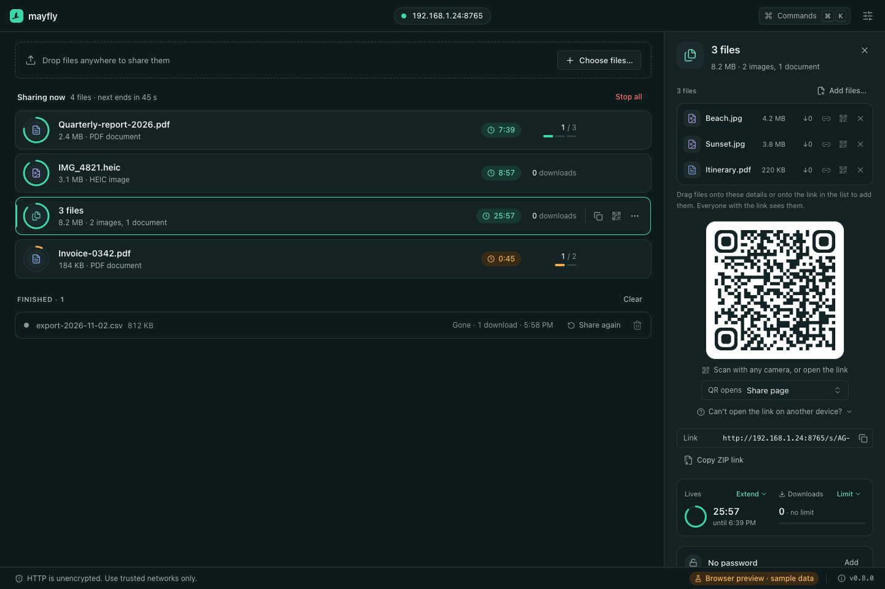

<p align="center">
  
</p>

<h1 align="center">Mayfly</h1>

<p align="center">
  <strong>Files that live for a moment.</strong><br>
  From your computer to any browser on your network.<br>
  One file or a few. One link. One quick QR scan.
</p>

<p align="center">
  <a href="https://phillippbertram.github.io/mayfly/"><strong>Website</strong></a> ·
  <a href="https://phillippbertram.github.io/mayfly/docs/">User manual</a> ·
  <a href="https://phillippbertram.github.io/mayfly/#download">Downloads</a>
</p>

Mayfly is a small desktop utility for macOS, Windows, and Linux. Drop in a few
files, scan the QR code with your phone, and download them in its browser,
directly from your computer over your local network. No cloud upload, no account,
no companion app. When you stop sharing, the link is gone.



<sub>Browser preview with sample data. No files are transferred.</sub>

> [!NOTE]
> **Mayfly is in development.** Real local sharing works in the desktop
> development build. Public installers, signed bundles, and acceptance on phones
> and every platform are still open. See [Status](#status) for what is verified.

> [!WARNING]
> **Current test packages have no verified publisher signature.** macOS uses
> ad-hoc signing without notarization; Windows installers are unsigned. Read
> [Installation and first launch](docs/installation.md) for checksum verification
> and the per-app macOS **Privacy & Security → Open Anyway** exception or Windows
> **More info → Run anyway**, when offered.

## How it works

1. **Choose your files.** Drop them onto the window or pick them, then set a
   lifetime and, if you like, a download limit or a password.
2. **Scan the code.** Point your phone's camera at the QR code, or copy the link.
   Both devices need to be on the same trusted network.
3. **Download.** Get a single file or everything as a ZIP, straight from your
   computer. Stop sharing when you're done.

Every share lives one short life: **Live**, then **Fading** in its last two
minutes, then **Gone**. Shares that are stopped or reach their download limit say
so plainly.

Close the window and sharing continues from the menu bar or tray. Quit Mayfly and
every share ends: the server stops, links stop working, and running downloads are
cancelled. A restart begins with a clean slate. If your desktop has no tray,
closing the window quits.

## What's inside

- **One link, many files.** Give a link a title, add or remove files later, or
  create an empty link first. The link and QR code stay the same; recipients
  refresh to see changes.
- **QR codes for every need.** Encode the share page, a single file, or the ZIP.
  Copy the code as an image or save it as PNG.
- **Lifetimes and limits.** Each share counts down. Download limits apply per
  file and are enforced by the backend, not the window.
- **Optional passwords.** Protect a share with a password the recipient enters in
  the browser.
- **Network aware.** Choose the advertised interface and port (8765 by default).
  The header always shows the listener's real state.
- **Link profiles.** Turn a share URL into a link for a compatible app on your
  phone. See [Link profiles](#link-profiles).
- **Light and dark.** Follows your system, or pick one.

## Trust and security

Mayfly keeps the metaphor out of security, so this part is plain:

- **HTTP is unencrypted. Use Mayfly only on trusted networks.** Anyone on the
  network can observe transfers, including share passwords and unlock credentials.
  A password limits who can open a share; it does not encrypt it.
- **A share link is a temporary credential.** Anyone who has it and can reach
  your computer can download an unprotected share until it expires, reaches its
  limit, or is stopped.
- **Only what you chose.** The server streams only files you explicitly selected,
  through pinned handles to the originals. Request paths are never treated as file
  paths, and there is no directory browsing.
- **Memory only.** Shares, tokens, and password verifiers live in memory and are
  invalid after a full restart. Only settings and link profiles are saved.
- **Nothing leaves your network.** No telemetry, cloud relay, or upload service.
  No port forwarding or public exposure is needed.

Guest Wi-Fi, client isolation, VPNs, or a firewall can keep your phone from
reaching your computer. The [security model](docs/security.md) covers counting,
retries, ranges, and cancellation in detail.

## Link profiles

The QR code opens the share page by default. In the share details you can switch
it to a single file, the ZIP, or a custom profile. A profile is a link template
for an app that is installed on the receiving device:

```text
myapp://import?url={encodedUrl}
```

Placeholders are `{url}`, `{encodedUrl}`, `{filename}`, `{encodedFilename}`, and
`{token}`. Mayfly validates and resolves templates in Rust and saves profiles
locally. It does not register schemes, install apps, or open links for you. Apps
that cannot show the browser password form cannot open protected shares. See
[ADR 0010](docs/decisions/0010-link-profiles-as-templates.md) and the
[product specification](docs/product.md#link-profiles).

Want to reach a device outside your Wi-Fi? The
[remote-sharing guide](docs/remote-sharing.md) compares Cloudflare Tunnel, ngrok,
Tailscale Serve, and Tailscale Funnel and their trust models. These setups are not
implemented or verified; local sharing stays the default.

## Status

The desktop app and the Rust sharing backend are implemented. Rust unit tests and
real HTTP integration tests cover the sharing services. A local macOS Apple
Silicon build and launch, and a four-target release CI run, are recorded in the
[development guide](docs/development.md#current-verification). None of this proves
a complete desktop-to-iPhone transfer or installed-bundle behavior on every
platform.

Still open:

- Native file selection and drop, QR clipboard and save, tray, and iPhone Safari
  acceptance. Automated HTTP tests do not cover these integrations.
- Installed-bundle acceptance on all supported systems and the final security
  audit (#7, #16).
- Developer ID signing, macOS notarization, and Windows signing (#14). macOS
  bundles are currently ad-hoc signed.
- Public installer downloads from the website (#13, #15, #17).
- Actual platform-added library and installer-component license review (#13, #16);
  dependency notices are included in website exports and application resources.

Resumable downloads, receiving files, a management API, a CLI, a cloud relay, and
in-app updates are separate follow-up issues. Universal Links and public HTTPS
are outside the MVP. The [roadmap](docs/roadmap.md) links the full backlog.

## Development

### Prerequisites

- Git.
- Node.js 24, recorded in `.nvmrc` and `.node-version`.
- pnpm 11.15.1, pinned in `package.json`.
- GitHub CLI (`gh`) for issues, or the GitHub web interface.
- For the native app: Rust via [rustup](https://rustup.rs/) and the
  [Tauri prerequisites](https://v2.tauri.app/start/prerequisites/) for your OS.

| Platform | Native prerequisites                                  |
| -------- | ----------------------------------------------------- |
| macOS    | Xcode Command Line Tools                              |
| Windows  | Microsoft C++ build tools and WebView2                |
| Linux    | Distribution-specific WebKitGTK and tray dependencies |

`rust-toolchain.toml` selects stable Rust with rustfmt and Clippy. Rust must be
on your shell's PATH; after a standard rustup install on macOS or Linux, run
`. "$HOME/.cargo/env"` in the current terminal. See
[Native development](docs/development.md#native-development) for persistent setup.

```sh
git clone git@github.com:phillippbertram/mayfly.git
cd mayfly
npm install --global pnpm@11.15.1
pnpm install --frozen-lockfile
pnpm check
```

### Run Mayfly

```sh
pnpm dev
```

This starts Vite and opens the native window against the real Rust backend. The
first run compiles Tauri's native dependencies and can take a few minutes. If port
1420 is taken, stop any running `pnpm dev:web` or earlier `pnpm dev` first; Tauri
starts its own Vite server there.

For a browser-only preview without Rust:

```sh
pnpm dev:web
```

Open <http://127.0.0.1:1420>. The preview runs a clearly labeled sample-data
simulator that shows every interface state. It binds to loopback, has no native
IPC, and shares nothing.

### Check and build

```sh
pnpm check        # Biome and strict TypeScript
pnpm format       # Apply Biome formatting
pnpm build:web    # Type-check and build the frontend
pnpm check:rust   # rustfmt and Clippy
cargo test --manifest-path apps/desktop/src-tauri/Cargo.toml --locked
pnpm build        # Package the native app for the current OS
```

Platform packages build on their own operating system with the Rust target
installed. Both macOS architectures build on a Mac.

| Command                  | Target                   | Packages               |
| ------------------------ | ------------------------ | ---------------------- |
| `pnpm build:macos`       | Current Mac architecture | `.app` and `.dmg`      |
| `pnpm build:macos:arm64` | macOS Apple Silicon      | `.app` and `.dmg`      |
| `pnpm build:macos:x64`   | macOS Intel              | `.app` and `.dmg`      |
| `pnpm build:windows`     | Windows x64 (MSVC)       | NSIS `.exe` installer  |
| `pnpm build:linux`       | Linux x64 (GNU)          | `.AppImage` and `.deb` |

[Local platform builds](docs/development.md#local-platform-builds) covers target
names, output paths, and verification status. Tagged releases are built by GitHub
Actions into draft releases; see [Releasing](docs/releasing.md).

### Stack

Tauri 2 and Rust, with Axum and Tokio for the embedded HTTP listener and
bounded-memory streaming. React, strict TypeScript, Vite, Tailwind CSS, Lucide,
Motion, and shadcn-style components on Radix primitives. The desktop app lives in
`apps/desktop`; shared packages are added only when needed.

### Website and manual

The [product website and user manual](https://phillippbertram.github.io/mayfly/)
(Next.js and Fumadocs) live in `apps/website` and are deployed to GitHub Pages.
Run `pnpm dev:website`, or `pnpm build:website` for a static export. Every manual
page links to its source with **Edit on GitHub**. The site lists installers once a
stable release exists, and it never hosts shared files. See the
[website guide](apps/website/README.md).

## Documentation

- [Product specification](docs/product.md): scope and acceptance criteria.
- [Architecture](docs/architecture.md): component boundaries, data flow, and persistence.
- [Security model](docs/security.md): requirements and validation cases.
- [Design concept](docs/design.md): interface, brand, and tone.
- [Development guide](docs/development.md): commands, tests, CI, and verification status.
- [Releasing](docs/releasing.md): versioning, the release workflow, and website downloads.
- [Installation](docs/installation.md): packages, signing warnings, and first launch.
- [Third-party licensing](docs/licensing.md): notices, source availability, and bundle review.
- [Decisions](docs/decisions/): architecture decision records.
- [Roadmap](docs/roadmap.md): index of the GitHub issue backlog.
- [Agent workflow](docs/agent-workflow.md): shared instructions across coding tools.
- [Contributing](CONTRIBUTING.md): issue and pull request workflow.

## Support

Did Mayfly save you a cable, a cloud upload, or a message to yourself? A coffee
keeps this small utility moving toward its first release. Thank you! ☕

<a href="https://buymeacoffee.com/phillippbertram"></a>

## License

Mayfly is licensed under the [Apache License 2.0](LICENSE). See [NOTICE](NOTICE)
and [ADR 0015](docs/decisions/0015-apache-license.md). Dependencies retain their own
terms; see [third-party notices](licenses/THIRD_PARTY_NOTICES.txt).
